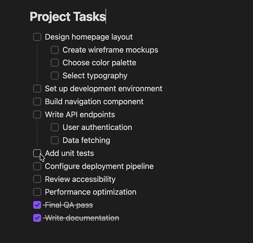
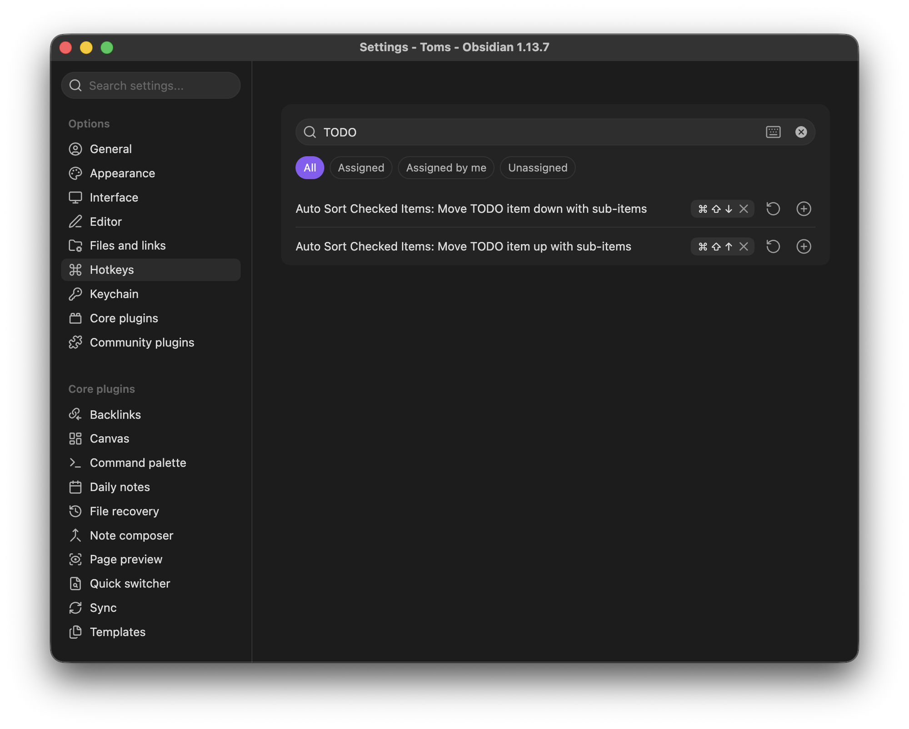

# Task Sweep



> Formerly **Auto Sort Checked Items**. The plugin ID remains unchanged, so existing installations update normally.

An [Obsidian](https://obsidian.md) plugin that sweeps completed tasks to the bottom while keeping nested branches together. Check an item to move it below the remaining work, or use hotkeys to move an entire TODO branch with all of its sub-items.

## Features

- ✅ **Auto-reorder** — Checked items slide to the bottom of their checkbox group
- 🪆 **Nesting-aware** — Items with sub-items move as a group, and indented items reorder within their own level
- ↕️ **Move whole TODO branches** — Move an item up or down together with all of its indented sub-items
- 📝 **Flexible list markers** — Works with `-`, `*`, and numbered checkbox lists
- 👁️ **Reading View support** — Completed tasks remain sorted below open tasks outside the editor
- ✨ **Smooth animation** — A ghost of the checked row visually slides to its new position
- ↩️ **Clean undo** — Cmd/Ctrl+Z undoes both the check and the move in one step

## Moving TODO items

Obsidian's built-in **Move line up** and **Move line down** commands only move one line. This plugin adds:

- **Task Sweep: Move TODO item up with sub-items**
- **Task Sweep: Move TODO item down with sub-items**

Assign hotkeys to these commands in **Settings → Hotkeys**. They are unassigned by default. Put the cursor on a checkbox item and the command will swap that item, including every indented line beneath it, with the adjacent checkbox item at the same indentation level.



## Installation

### Manual

1. Download `main.js` and `manifest.json` from the [latest release](https://github.com/tom-un/obsidian-checkbox-reorder/releases)
2. Create a folder called `auto-sort-checked-items` in your vault's `.obsidian/plugins/` directory
3. Place both files inside it
4. In Obsidian, go to **Settings → Community plugins** and enable **Task Sweep**

### From source

```bash
git clone https://github.com/tom-un/obsidian-checkbox-reorder.git
cd obsidian-checkbox-reorder
npm install
npm run build
```

Then copy the folder (or symlink it) into your vault's `.obsidian/plugins/` directory.

## Development

```bash
npm run dev    # Watch mode — rebuilds on file changes
npm test       # Run unit tests
npm run test:coverage  # Run tests and enforce core coverage thresholds
npm run build  # Production build
```

Coverage is enforced at 100% for the deterministic sorting, subtree movement, reading-order, and animation-positioning modules. The Obsidian and CodeMirror integration shell still requires an in-app smoke test.

## License

MIT
